# RevoShop Frontend

## Overview

RevoShop is the frontend for an online store, built with Next.js (App Router). It lets shoppers browse products, search the catalog, add items to a cart, and place orders, while giving admins a dashboard to manage products and categories. The app talks to a separate backend REST API (the Module 2 Flask service) through the `NEXT_PUBLIC_API_BASE_URL` environment variable, and keeps the user session and cart in the browser via `localStorage`.

## Features Implemented

### Pages

- **Home (`/`)** — Landing page with the RevoShop branding and intro content.
- **Products (`/products`)** — Server-rendered product listing fetched from the backend, with a link to the live product search.
- **Product search (`/products/search`)** — Client-side live search over the catalog, with a running cart summary (total items and total price).
- **Categories (`/categories`)** — Lists product categories fetched from the backend.
- **Cart (`/cart`)** — Shows items added to the cart, grouped per product with a quantity column and per-line subtotals. Supports removing items and checking out. Checkout sends `POST /orders` to the backend, shows a success message, then redirects to the orders page. Protected route (login required).
- **Orders (`/orders`)** — Lists the signed-in user's orders (id, status, total). Protected route (login required).
- **Login (`/login`)** — Authenticates against the backend and stores the user and token.
- **Register (`/register`)** — Account registration with client-side validation.
- **Admin dashboard (`/dashboard`)** — Admin-only product management with full CRUD (create, edit, delete) and inline success notifications.
- **Admin categories (`/dashboard/categories`)** — Admin-only category management.

### Major functionality

- **Authentication & session** — Login/register flows backed by the API. The signed-in user and token are persisted in `localStorage` and restored on reload via `AuthContext`.
- **Role-based access** — Route guards (`ProtectedRoute`, `AdminRoute`, `PublicOnlyRoute`) restrict pages based on login state and the user's role.
- **Shopping cart** — Cart state lives in `CartContext` and is persisted to `localStorage`. Adding the same product again increases its quantity instead of creating a duplicate row. Cart counts reflect the total quantity across all items.
- **Checkout → orders** — The cart page posts the order to the backend, clears the cart, and navigates to `/orders` using `next/navigation`.
- **Admin product & category CRUD** — Create, update, and delete products and categories from the dashboard, with client-side form validation.
- **Live product search** — Filter the catalog on the client with an always-visible cart summary.
- **In-app notifications** — Lightweight success messages (e.g. after creating/updating/deleting a product) implemented with local component state.

## Technologies Used

- **Next.js** (App Router) — framework and server-side rendering.
- **React** — UI components and hooks.
- **TypeScript** — static typing across the codebase.
- **Tailwind CSS** — styling.
- **`next/navigation`** — client-side routing and redirects (e.g. after checkout).
- **`localStorage`** — session (user + token) and cart persistence in the browser.
- **`NEXT_PUBLIC_API_BASE_URL`** — environment variable pointing the frontend at the backend REST API.
- **Playwright** — end-to-end testing, with a mock backend server so tests run without the real API.

## Getting Started

### Prerequisites

- Node.js 18+ and npm
- A running backend API, or use the mock server bundled with the tests

### 1. Install dependencies

```bash
npm install
```

### 2. Configure environment variables

Copy the example file and set the backend URL:

```bash
cp .env.example .env.local
```

Then edit `.env.local`:

```bash
NEXT_PUBLIC_API_BASE_URL=http://localhost:5000   # your backend API base URL
API_SECRET_KEY=your-secret-key
```

`NEXT_PUBLIC_API_BASE_URL` must point to the backend REST API (the Module 2 service). All product, category, auth, and order requests are sent to this URL.

### 3. Run the development server

```bash
npm run dev
```

Open [http://localhost:3000](http://localhost:3000) in your browser.

### 4. Build for production (optional)

```bash
npm run build
npm run start
```

## Running the Test Suite (Playwright)

The project uses Playwright for end-to-end tests. A mock backend server (`tests/mock-server/server.mjs`) is started automatically on port `4000`, and the Next.js dev server is launched with `NEXT_PUBLIC_API_BASE_URL` pointed at the mock. You do **not** need the real backend running to execute the tests.

### 1. Install Playwright browsers (first time only)

```bash
npx playwright install
```

### 2. Run all tests

```bash
npx playwright test
```

### 3. Useful variations

```bash
# Run a single test file
npx playwright test cart.spec.ts

# Run only in Chromium
npx playwright test --project=chromium

# Run in headed (visible browser) mode
npx playwright test --headed

# Open the interactive UI runner
npx playwright test --ui
```

### 4. View the HTML report

```bash
npx playwright show-report
```

## Screenshots

Local demo evidence for this assignment.

### Products listing
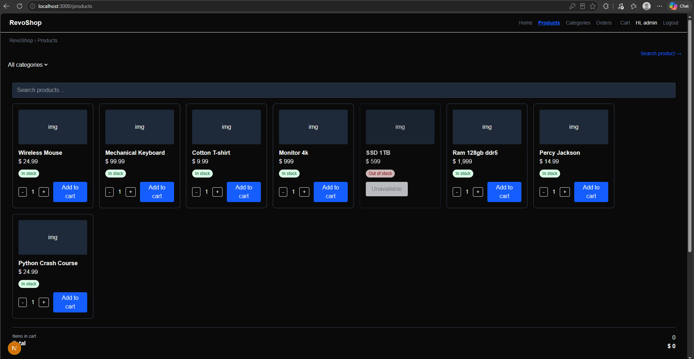

### Product detail
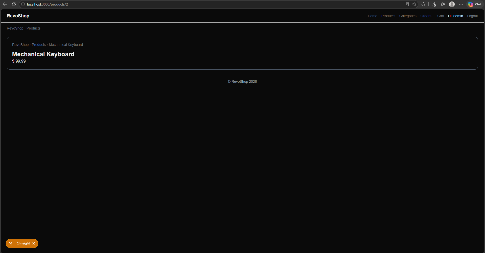

### Cart page
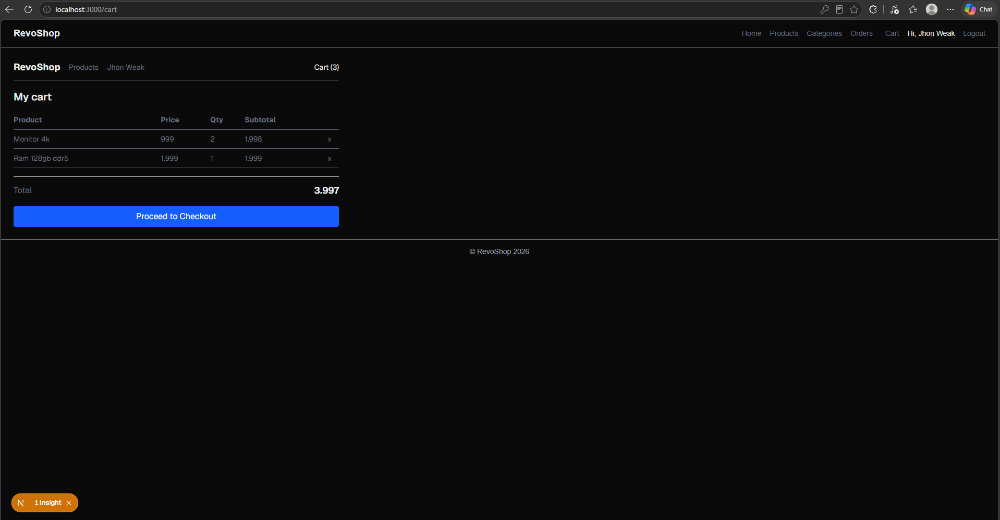

### Orders page
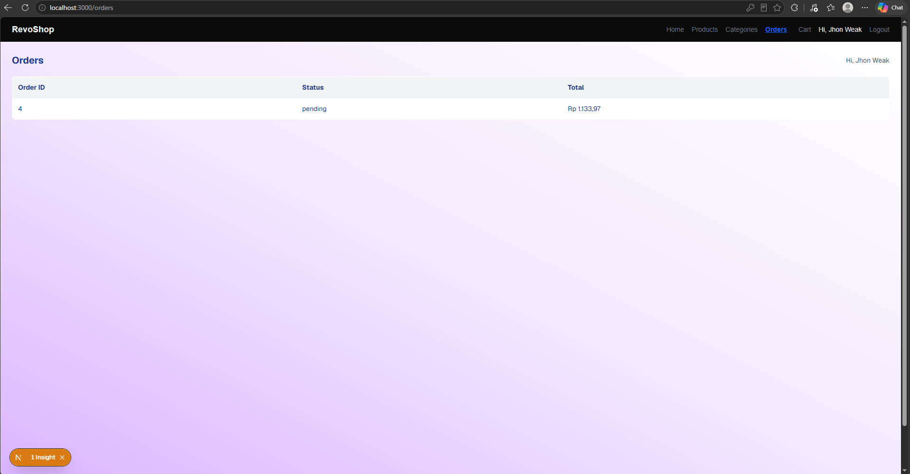

### Login page
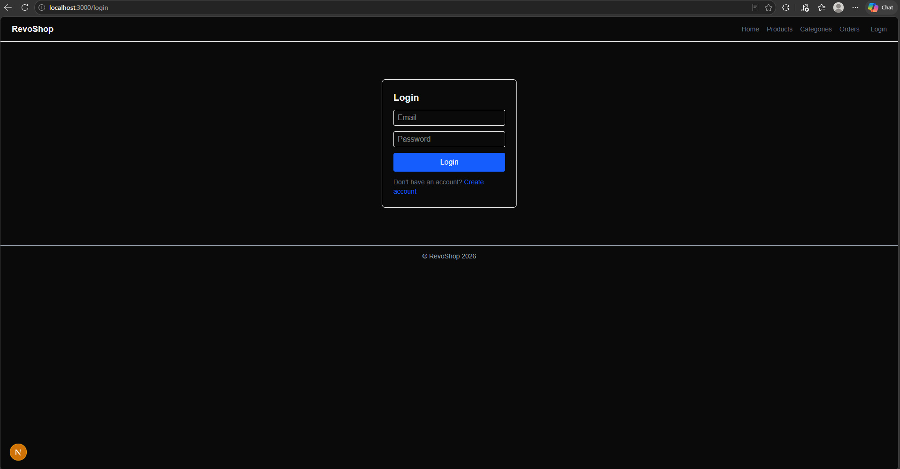

### Register page
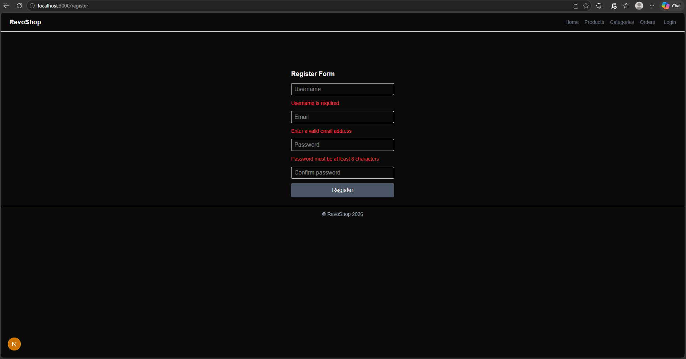

### Admin dashboard
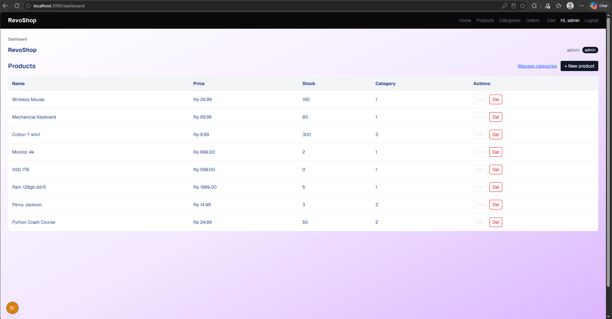

### Admin dashboard - categories
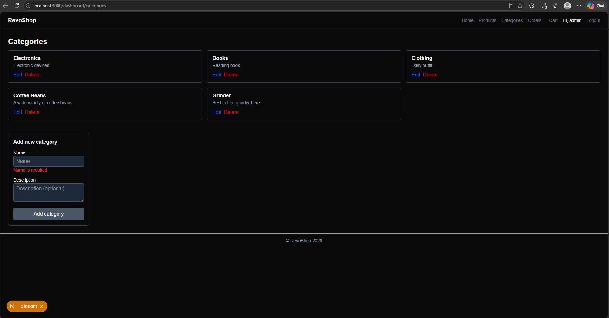

### End-to-End Test Register & login journey
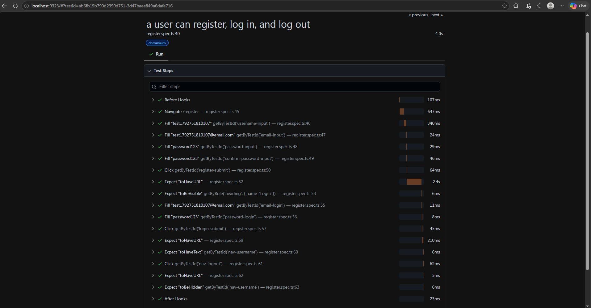

### End-to-End Test User checkout journey
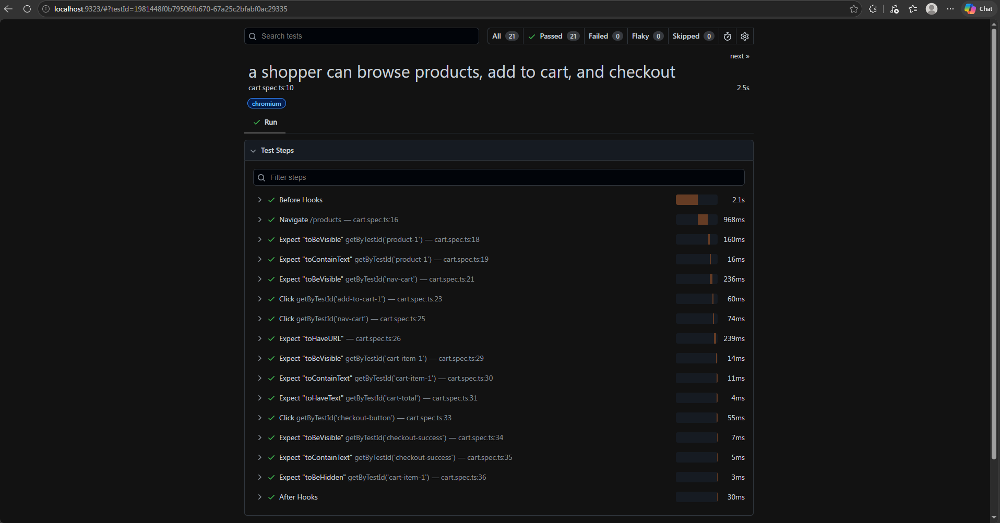

### End-to-End Test Full CRUD (admin)
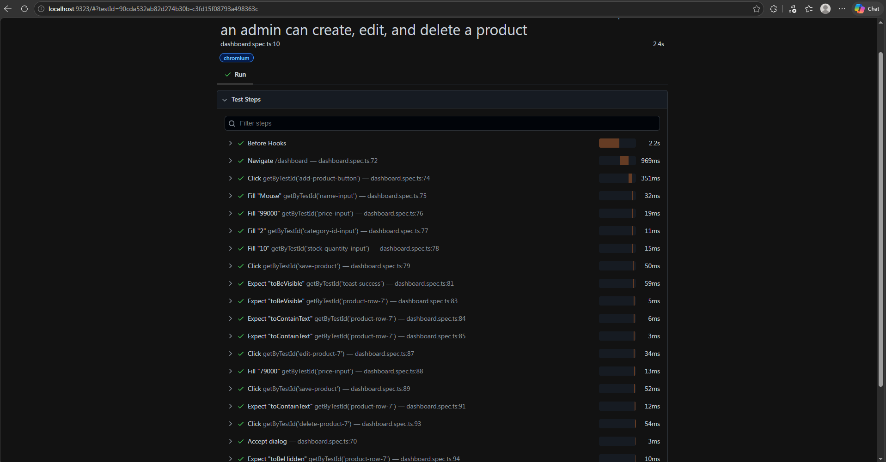
